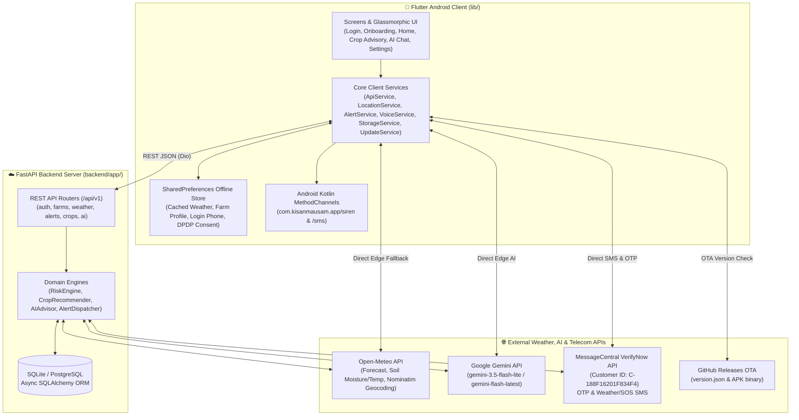
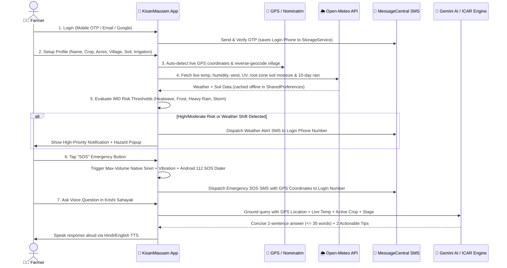
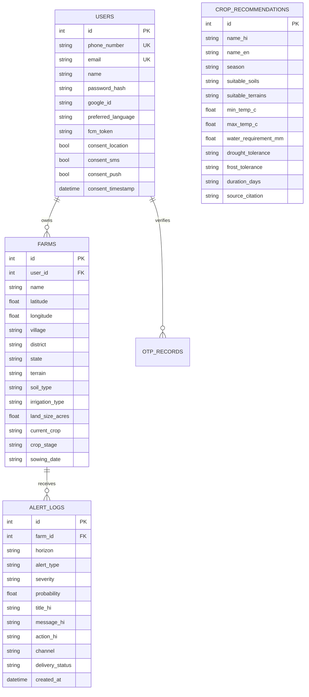

# किसान मौसम (KisanMausam) — Complete System Architecture, Frontend, Backend, UI Design, APIs & Functionalities

**Version:** `1.1.5+15`  
**Primary Language:** Hindi-First (`hi-IN`) with full Bilingual English (`en-IN`) toggle  
**Target Platform:** Android (Flutter Material 3 + Kotlin Native Platform Channels) & FastAPI Cloud Backend  
**Compliance Standards:** India Meteorological Department (IMD) Hazard Thresholds, ICAR Package of Practices, TRAI DLT Transactional SMS, DPDP Act 2023

---

## 1. System Architecture

KisanMausam follows a **Resilient Hybrid Edge + Cloud Architecture** designed specifically for rural Indian farmers who may experience intermittent 2G/3G/4G connectivity. Every major subsystem (Weather, Risk Engine, Crop Recommender, AI Krishi Sahayak, and SMS Alerting) operates seamlessly both through the FastAPI backend and directly from the mobile edge with offline caching.

### 1.1 High-Level Architecture Diagram

### 1.2 End-to-End User & Data Flow

---

## 2. Frontend Architecture (`app/lib/`)

The mobile application is built with **Flutter (Dart 3.13+)** using Material 3, custom glassmorphism, animated custom painters for weather visuals, native Android Kotlin bridges, and strict bilingual localization (`hi` and `en`).

### 2.1 Directory & Module Structure

| File Path | Layer | Responsibility |
| :--- | :--- | :--- |
| [`app/lib/main.dart`](file:///c:/Users/nikki/Documents/Kishan%20Weather/app/lib/main.dart) | Entrypoint & State Router | Manages onboarding state machine (`_onboardingStep` 0–4), theme mode, high-contrast toggle, language switching, and profile revision syncing. |
| [`app/lib/l10n/app_strings.dart`](file:///c:/Users/nikki/Documents/Kishan%20Weather/app/lib/l10n/app_strings.dart) | Localization (`hi` / `en`) | Complete dictionary of Hindi (`hi`) and English (`en`) UI strings across all screens, dialogs, and notifications. |
| [`app/lib/theme/app_theme.dart`](file:///c:/Users/nikki/Documents/Kishan%20Weather/app/lib/theme/app_theme.dart) | Design System | Defines `lightTheme()`, `darkTheme()`, and `highContrastTheme()` (for outdoor sunlight readability). |
| [`app/lib/models/farm_profile.dart`](file:///c:/Users/nikki/Documents/Kishan%20Weather/app/lib/models/farm_profile.dart) | Data Model | Represents a farmer's plot (`id`, `name`, `latitude`, `longitude`, `village`, `district`, `state`, `terrain`, `soilType`, `irrigationType`, `landSizeAcres`, `currentCrop`, `cropStage`, `sowingDate`) with bilingual getters. |
| [`app/lib/models/weather_models.dart`](file:///c:/Users/nikki/Documents/Kishan%20Weather/app/lib/models/weather_models.dart) | Data Model | Parses Open-Meteo `CurrentWeather`, `HourlyForecast`, `DailyForecast`, and `WeatherData` with JSON serialization for offline caching. |
| [`app/lib/models/risk_models.dart`](file:///c:/Users/nikki/Documents/Kishan%20Weather/app/lib/models/risk_models.dart) | Data Model | Models `DetectedRisk`, `HorizonRiskSummary` (Horizon 1: 1–3 days, Horizon 2: 4–10 days, Horizon 3: 15–30 day seasonal outlook), and `FarmRiskData`. |
| [`app/lib/screens/onboarding/login_screen.dart`](file:///c:/Users/nikki/Documents/Kishan%20Weather/app/lib/screens/onboarding/login_screen.dart) | Onboarding UI | Supports Email/Mobile + Password Sign-In/Sign-Up, Google Sign-In, and Mobile OTP login; persists the login phone number to `StorageService`. |
| [`app/lib/screens/onboarding/otp_screen.dart`](file:///c:/Users/nikki/Documents/Kishan%20Weather/app/lib/screens/onboarding/otp_screen.dart) | Onboarding UI | Sends and verifies 4/6-digit SMS OTP via MessageCentral VerifyNow API (`C-188F16201F834F4`). |
| [`app/lib/screens/onboarding/language_screen.dart`](file:///c:/Users/nikki/Documents/Kishan%20Weather/app/lib/screens/onboarding/language_screen.dart) | Onboarding UI | Step 1 of setup: selects **हिंदी (Hindi)** or **English** with instant preview. |
| [`app/lib/screens/onboarding/consent_screen.dart`](file:///c:/Users/nikki/Documents/Kishan%20Weather/app/lib/screens/onboarding/consent_screen.dart) | Onboarding UI | Step 3 of setup: DPDP Act 2023 granular consent toggles (GPS Location, Transactional SMS Alerts, Push Notifications) with audio readout. |
| [`app/lib/screens/onboarding/farm_setup_screen.dart`](file:///c:/Users/nikki/Documents/Kishan%20Weather/app/lib/screens/onboarding/farm_setup_screen.dart) | Onboarding & Profile Editor | Step 4 of setup & Settings Profile Editor (`isEditing: true`): captures Farmer Name, Farm Name, Village, District, Current Crop (10 quick-select chips + custom input), Land Area (Acres), Crop Stage, Terrain, Soil Type, and Irrigation. |
| [`app/lib/screens/home/weather_home_screen.dart`](file:///c:/Users/nikki/Documents/Kishan%20Weather/app/lib/screens/home/weather_home_screen.dart) | Main Dashboard UI | Displays Top Location/Farm Switcher, Top Crop Advisory Card, OTA Update Banner, Current Weather Hero Card, Weather Risk & SOS Card, Soil Health Card, and Sunrise/Sunset Card. |
| [`app/lib/screens/crops/crop_recommender_screen.dart`](file:///c:/Users/nikki/Documents/Kishan%20Weather/app/lib/screens/crops/crop_recommender_screen.dart) | Crop Advisory UI | Ranks the Top 5 ICAR-recommended crops dynamically calibrated to live GPS temperature, soil moisture, and 10-day rainfall. |
| [`app/lib/screens/chat/krishi_sahayak_screen.dart`](file:///c:/Users/nikki/Documents/Kishan%20Weather/app/lib/screens/chat/krishi_sahayak_screen.dart) | Voice & AI Chat UI | Bilingual voice-enabled AI agronomist with single-utterance STT, TTS audio playback with animated waveform, quick chips, and KVK helpline integration. |
| [`app/lib/screens/settings/settings_screen.dart`](file:///c:/Users/nikki/Documents/Kishan%20Weather/app/lib/screens/settings/settings_screen.dart) | Settings & Profile UI | Displays Farmer & Crop Profile summary card with edit button, Language switcher, Outdoor High-Contrast toggle, DPDP Privacy & Data Deletion, OTA Update checker, and hidden 7-tap Developer Server Config. |
| [`app/lib/widgets/realistic_weather_visual.dart`](file:///c:/Users/nikki/Documents/Kishan%20Weather/app/lib/widgets/realistic_weather_visual.dart) | Custom Painter Widget | Hardware-accelerated `CustomPainter` rendering animated sun rays, glowing moon/stars, drifting multi-layered clouds, falling raindrops, and lightning flashes based on WMO weather codes. |
| [`app/lib/widgets/glass_card.dart`](file:///c:/Users/nikki/Documents/Kishan%20Weather/app/lib/widgets/glass_card.dart) | Reusable UI Widget | Frosted glassmorphic container using `BackdropFilter` (`ImageFilter.blur`) with subtle borders and elevation. |
| [`app/lib/widgets/mic_button.dart`](file:///c:/Users/nikki/Documents/Kishan%20Weather/app/lib/widgets/mic_button.dart) | Reusable UI Widget | Bottom-right floating action pill (`ProminentMicButton`) for 1-tap access to the Krishi Sahayak voice assistant. |

### 2.2 Native Android Integration (`MainActivity.kt`)

Located at [`app/android/app/src/main/kotlin/com/kisanmausam/app/MainActivity.kt`](file:///c:/Users/nikki/Documents/Kishan%20Weather/app/android/app/src/main/kotlin/com/kisanmausam/app/MainActivity.kt):
- **Play Protect & Chrome Safe Browsing Compliance:** Does **not** declare restricted `SEND_SMS` permissions or `SmsManager` bytecode calls, ensuring zero security warnings during APK download and installation.
- **Channel 1 (`com.kisanmausam.app/siren`):**
  - `startSiren`: Boosts `AudioManager.STREAM_ALARM`, `STREAM_MUSIC`, and `STREAM_RING` to 100% hardware volume; launches an alternating dual-frequency (`960 Hz` / `1420 Hz`) emergency square-wave PCM synthesizer via `AudioTrack` (`USAGE_ALARM`), layered with the system alarm ringtone and a continuous SOS vibration waveform (`[0, 500, 150, 500, 150, 900, 250]`).
  - `stopSiren`: Halts the PCM synth thread, stops the alarm ringtone, and cancels hardware vibration.
  - `triggerAndroidSos`: Opens the native Android emergency dialer (`Intent.ACTION_DIAL`, `tel:112`).
- **Channel 2 (`com.kisanmausam.app/sms`):**
  - Safely handles `requestSmsPermission` and `getSimPhoneNumber` (via `TelephonyManager` when `READ_PHONE_NUMBERS` / `READ_PHONE_STATE` is granted) so the app can pre-fill the user's SIM number during login.

---

## 3. Detailed UI Design & Visual System

### 3.1 Color Palette & Typography

| Token | Hex Code | Usage |
| :--- | :--- | :--- |
| **Primary Lush Crop Green** | `#1B5E20` | Primary buttons, AppBar headers, active badges, agricultural icons |
| **Secondary Pasture Green** | `#2E7D32` / `#388E3C` | Gradients, positive safe-farm indicators, secondary chips |
| **Fertile Soil Terracotta** | `#BF360C` / `#E65100` | Voice Assistant FAB (`ProminentMicButton`), soil temperature accents |
| **Ripe Wheat Gold** | `#F9A825` / `#FFD54F` | Season badges (`रबी सीजन`), UV index pod, warning highlights |
| **Monsoon Sky Blue** | `#0288D1` / `#4FC3F7` | Soil moisture metrics, rainfall indicators, humidity pods |
| **Red Hazard Alert** | `#B71C1C` / `#D32F2F` | High-risk IMD warnings, SOS button, emergency banners |
| **Ambient Mist Background** | `#E8F5E9` → `#F7FAF7` | Soft vertical linear gradient across the home dashboard |
| **Outdoor High-Contrast Mode** | `#004D20` on `#FFFFFF` | Pure white cards with `2px` solid `#000000` borders and `20sp` bold typography for direct midday sunlight |

### 3.2 Dynamic Weather Hero Gradients
The main weather hero card (`_buildCurrentWeatherHero`) dynamically adapts its 3-stop diagonal gradient and `RealisticWeatherVisual` animation to real-time conditions:
- **Clear Day:** `['#134E2C', '#1E6F3E', '#2E8B57']` (Emerald crop canopy gradient)
- **Clear Night:** `['#0F172A', '#1E293B', '#0D1B2A']` (Starry midnight slate gradient)
- **Rain / Drizzle (WMO 51–82):** `['#0D324D', '#1D536D', '#176B87']` (Deep monsoon ocean gradient)
- **Thunderstorm / Hail (WMO 95–99):** `['#281C3E', '#39255C', '#4A3470']` (Stormy indigo-violet gradient)
- **Severe Heat ($\ge 38^\circ\text{C}$):** `['#7A1F02', '#A03006', '#BF360C']` (intense terracotta heat gradient)

### 3.3 Screen-by-Screen UI Layout

1. **Login & Account Creation Screen ([`login_screen.dart`](file:///c:/Users/nikki/Documents/Kishan%20Weather/app/lib/screens/onboarding/login_screen.dart))**
   - Bilingual language pill in the top-right corner (`हिंदी` / `EN`).
   - Mode toggle tabs: **लॉगिन (Login)** vs. **खाता बनाएं (Create Account)**.
   - Input fields for Email/Mobile, Mobile Number (for SMS alerts), and Password.
   - One-tap **Google से जारी रखें (Continue with Google)** and **मोबाइल OTP से जारी रखें (Continue with Mobile OTP)** buttons.
2. **Farmer & Farm Setup Screen ([`farm_setup_screen.dart`](file:///c:/Users/nikki/Documents/Kishan%20Weather/app/lib/screens/onboarding/farm_setup_screen.dart))**
   - Triggered automatically for every new account setup (including Phone OTP login) and accessible anytime from Settings.
   - **Row 1:** Farmer Name (`किसान का नाम`) + Farm Name (`खेत का नाम`).
   - **Row 2:** Village (`गाँव`) + District (`जिला`).
   - **Crop Selector:** 10 one-tap `ChoiceChip`s (*गेहूं/Wheat, धान/Paddy, चना/Chickpea, सरसों/Mustard, मक्का/Maize, गन्ना/Sugarcane, कपास/Cotton, आलू/Potato, सोयाबीन/Soybean, सब्जियां/Vegetables*) + custom crop text field + Land Area in Acres (`भूमि क्षेत्र - एकड़`).
   - **Agronomic Pickers:** Crop Stage (`बुवाई`, `वानस्पतिक विकास`, `फूल आना`, `दाना भरना`, `कटाई`), Terrain (`समतल`, `ढलान`, `निचली भूमि`), Soil Type (`काली मिट्टी`, `दोमट`, `बलुई`, `लाल`), and Irrigation System (`ट्यूबवेल`, `नहर`, `ड्रिप`, `वर्षा आधारित`).
3. **Weather Home Dashboard ([`weather_home_screen.dart`](file:///c:/Users/nikki/Documents/Kishan%20Weather/app/lib/screens/home/weather_home_screen.dart))**
   - **Top Glass Bar:** Shows active Location/Farm name, active Crop & Land Area (`🌾 गेहूं (2.5 एकड़) • GPS ...`), dropdown trigger for GPS auto-locate / city search, and Settings gear icon.
   - **Top Crop Advisory Card:** 1-tap navigation card right at the top showing live GPS temperature, soil moisture percentage, and season badge (`रबी सीजन`).
   - **Last Updated Glass Pill:** Shows exact cache freshness (`अभी-अभी` / `Just now`).
   - **Current Weather Hero Card:** Giant `70sp` temperature readout, `RealisticWeatherVisual` animation, "Feels Like" pill, and a frosted 3-column metrics pod (Wind Speed `km/h`, Relative Humidity `%`, UV Index).
   - **Weather Risk & Early Warning Card (`मौसम जोखिम व पूर्व चेतावनी`):**
     - Full-width header with status icon, title (`मौसम जोखिम व पूर्व चेतावनी`), and active status dot (`• सक्रिय चेतावनी` / `• खेत सुरक्षित`).
     - Dedicated 2-column action row right below the title with balanced **`SOS`** (red emergency) and **`टेस्ट अलर्ट` (`Test Alert`)** buttons.
     - Displays active Horizon-1 (1–3 day) red/orange hazard cards with probability `%`, expected value, and yellow lightbulb actionable advice, plus the 30-day seasonal rainfall outlook.
   - **Soil Health & Root Zone Card (`मिट्टी का स्वास्थ्य`):** Displays `0 cm` Soil Temperature (`°C`) and `0–1 cm` Root-Zone Soil Moisture (`%` and `m³/m³`).
   - **Sun Cycle Card:** Displays local Sunrise (`सूर्योदय`) and Sunset (`सूर्यास्त`) times.
   - **Floating Action Button:** Bottom-right `ProminentMicButton` (`बोलकर पूछें` / `Ask by Voice`).
4. **GPS Crop Advisory Screen ([`crop_recommender_screen.dart`](file:///c:/Users/nikki/Documents/Kishan%20Weather/app/lib/screens/crops/crop_recommender_screen.dart))**
   - Live GPS Grounded banner displaying current temperature, soil moisture, and 10-day cumulative rainfall.
   - Mandatory ICAR/KVK Expert Review notice banner.
   - Top 5 ranked crop cards with rank avatar (`#1`–`#5`), suitability match percentage badge (`97% उपयुक्त`), trait chips (Duration, Water need in `mm`, Drought tolerance, Frost tolerance), bulleted suitability reasons, risk notes, drought-tolerant alternative, and ICAR source citation.
5. **Krishi Sahayak AI Voice & Chat Screen ([`krishi_sahayak_screen.dart`](file:///c:/Users/nikki/Documents/Kishan%20Weather/app/lib/screens/chat/krishi_sahayak_screen.dart))**
   - Frosted glass header with active GPS location, farmer's configured crop, AI online indicator, and Gemini API key configuration button.
   - ICAR compliance banner with 1-tap `KVK` call button (`1800-180-1551`).
   - Chat stream with user bubbles and assistant cards featuring a **"सुनें" (`Listen`)** TTS replay button, **"महत्वपूर्ण कार्य" (`Action Points`)** checklist, and clickable KVK helpline footer.
   - Horizontal carousel of 8 quick-ask agricultural question chips.
   - Bottom input bar with pulsing radar push-to-talk mic button (buffers speech and sends a single consolidated message when the user stops speaking).

---

## 4. Backend Architecture (`backend/app/`)

The backend is built with **Python FastAPI**, **Async SQLAlchemy 2.0 (`aiosqlite` / `asyncpg`)**, **Pydantic v2**, and **HTTPX**.

### 4.1 Database Schema (`backend/app/models/`)

---

## 5. Complete API Reference

### 5.1 FastAPI Backend Endpoints (`/api/v1`)

| Method | Endpoint | Router | Description |
| :--- | :--- | :--- | :--- |
| `GET` | `/` | `main.py` | Health check, DPDP compliance status, and Open-Meteo attribution. |
| `GET` | `/api/v1/app/version` | `main.py` | Returns latest release version metadata and APK download URL. |
| `POST` | `/api/v1/auth/otp/send` | `auth.py` | Sends a 4/6-digit SMS OTP to an Indian mobile number (`+91`) via MessageCentral / Fast2SMS. |
| `POST` | `/api/v1/auth/otp/verify` | `auth.py` | Verifies OTP code and creates/returns the authenticated `User` record. |
| `POST` | `/api/v1/auth/register` | `auth.py` | Registers a new farmer account with email/phone, name, and SHA-256 salted password hash. |
| `POST` | `/api/v1/auth/login` | `auth.py` | Authenticates farmer via email/phone + password. |
| `POST` | `/api/v1/auth/google` | `auth.py` | Authenticates or registers a farmer via Google OAuth profile. |
| `POST` | `/api/v1/auth/consent` | `auth.py` | Updates DPDP Act 2023 granular consent flags (`consent_location`, `consent_sms`, `consent_push`). |
| `DELETE` | `/api/v1/auth/users/{user_id}/data` | `auth.py` | Right to Erasure (DPDP Act 2023): permanently deletes user, farms, and alert logs. |
| `POST` | `/api/v1/farms/` | `farms.py` | Creates a new `Farm` profile with coordinates, crop, land size, soil, and irrigation details. |
| `GET` | `/api/v1/farms/` | `farms.py` | Lists all farm profiles (optionally filtered by `user_id`). |
| `GET` | `/api/v1/farms/{farm_id}` | `farms.py` | Retrieves a specific farm profile by ID. |
| `DELETE` | `/api/v1/farms/{farm_id}` | `farms.py` | Deletes a farm profile. |
| `GET` | `/api/v1/weather/forecast` | `weather.py` | Fetches 48-hour hourly and 10-day daily weather + root-zone soil forecast for `latitude` & `longitude`. |
| `GET` | `/api/v1/weather/enso` | `weather.py` | Returns NOAA CPC / IRI ENSO phase (El Niño / La Niña / Neutral) and ONI index. |
| `GET` | `/api/v1/farms/{farm_id}/alerts/risk` | `alerts.py` | Evaluates 3-horizon IMD weather risks (`horizon_1_immediate`, `horizon_2_medium`, `horizon_3_seasonal`) for a farm. |
| `POST` | `/api/v1/farms/{farm_id}/alerts/simulate` | `alerts.py` | Triggers a simulated hazard (`sos`, `weather_change`, `frost`, `heavy_rain`, `heat_wave`) and dispatches SMS & push logs. |
| `GET` | `/api/v1/farms/{farm_id}/alerts/history` | `alerts.py` | Returns historical `AlertLog` entries dispatched for the farm. |
| `GET` | `/api/v1/farms/{farm_id}/crops/recommendations` | `crops.py` | Computes top 5 seasonal crop recommendations scored by soil type, irrigation, and 30-day rain outlook. |
| `POST` | `/api/v1/farms/{farm_id}/ai/chat` | `ai.py` | Grounds farmer's question with live weather, location, and crop context, returning a concise Hindi/English advisory and actionable tips. |
| `GET` | `/api/v1/aws/status` | `aws_cloud.py` | Returns live AWS Cloud Architecture status, region (`ap-south-1`), and configuration of all 14 integrated AWS services. |
| `POST` | `/api/v1/aws/polly/synthesize` | `aws_cloud.py` | Synthesizes natural Hindi (`hi-IN`) or Indian English (`en-IN`) neural speech audio using **Amazon Polly (`Kajal`)**. |
| `POST` | `/api/v1/aws/translate` | `aws_cloud.py` | Translates weather warnings & crop advisories across 9 Indian languages (`hi`, `en`, `mr`, `pa`, `gu`, `ta`, `te`, `kn`, `bn`) via **Amazon Translate**. |
| `POST` | `/api/v1/aws/telemetry/archive` | `aws_cloud.py` | Archives encrypted (`AES-256`) farm weather/soil snapshots to **Amazon S3** and caches geohash cells in **Amazon DynamoDB**. |
| `POST` | `/api/v1/aws/sns/broadcast` | `aws_cloud.py` | Publishes emergency weather/SOS alerts to **Amazon SNS** (`KisanMausamHazardTopic`) and dispatches Transactional DLT SMS. |

### 5.2 External APIs Integrated

1. **Open-Meteo Weather & Soil API (`https://api.open-meteo.com/v1/forecast`)**
   - **Current Variables:** `temperature_2m`, `relative_humidity_2m`, `apparent_temperature`, `is_day`, `precipitation`, `rain`, `weather_code`, `wind_speed_10m`, `wind_gusts_10m`, `uv_index`, `soil_temperature_0cm`, `soil_moisture_0_to_1cm`.
   - **Hourly Variables:** `temperature_2m`, `precipitation_probability`, `precipitation`, `weather_code`, `wind_speed_10m`, `relative_humidity_2m`.
   - **Daily Variables:** `weather_code`, `temperature_2m_max`, `temperature_2m_min`, `sunrise`, `sunset`, `uv_index_max`, `precipitation_sum`, `precipitation_probability_max`, `wind_speed_10m_max`.
   - **License:** CC BY 4.0 (Non-commercial attribution displayed in app footer and Settings).
2. **Open-Meteo Geocoding & OpenStreetMap Nominatim API**
   - Forward geocoding (`https://geocoding-api.open-meteo.com/v1/search`) for village/city search.
   - Reverse geocoding (`https://nominatim.openstreetmap.org/reverse`) for converting live GPS coordinates into exact village/district names in Hindi/English.
   - Multi-provider IP Geolocation fallback (`ipwho.is` → `ipapi.co` → `freeipapi.com`) when indoor GPS is unavailable.
3. **Google Gemini & Amazon Bedrock Generative AI Cascade**
   - **Models Cascade:** `gemini-3.5-flash-lite` → `gemini-3.8-flash` → `gemini-flash-latest` → **Amazon Bedrock (`anthropic.claude-3-haiku-20240307-v1:0`)** → ICAR Grounded Rule Engine.
   - **System Instruction Grounding:** Injects live `village`, `(Lat, Lon)`, `activeCrop`, `cropStage`, `temperature`, `weatherCondition`, `humidity`, and `windSpeed`.
   - **Strict Output Cap:** `maxOutputTokens: 160`, `temperature: 0.2`, enforcing a maximum of 2 short, to-the-point sentences ($\le 35$ words) plus 2 actionable bullet points and KVK helpline `1800-180-1551`.
4. **MessageCentral VerifyNow & Amazon SNS Transactional SMS**
   - **Customer ID:** `C-188F16201F834F4`
   - **OTP Send & Validate (`/verification/v3/send` & `/verification/v3/validateOtp`):** Used strictly during phone number login (`OtpScreen`).
   - **Transactional Weather & SOS SMS (Amazon SNS `AWS.SNS.SMS.SenderID=KSNMSM` + Native Android `SmsManager`):** Dispatches real-time weather change alerts, IMD hazard warnings, and emergency SOS messages directly to the phone number saved at login.
5. **GitHub Releases & Amazon CloudFront OTA Update Feed**
   - Checks `https://raw.githubusercontent.com/kumarnikki/Kisan-Mausam/main/version.json` and `https://api.github.com/repos/kumarnikki/Kisan-Mausam/releases/latest` to display an in-app update banner and 1-tap APK downloader.

---

## 6. Core Functionalities & Domain Logic

### 6.1 Multi-Horizon IMD Weather Risk Engine
Evaluates live and forecast weather against India Meteorological Department (IMD) agricultural thresholds:
- **Heat Stress / Severe Heatwave (`heat_wave`):** Triggered when 3-day max temperature $\ge 35^\circ\text{C}$ (Orange Alert) or $\ge 40^\circ\text{C}$ (Red Alert). Recommends evening irrigation after 5 PM and organic straw mulching.
- **Heavy Rainfall & Waterlogging (`heavy_rain`):** Triggered when 3-day rain probability $\ge 35\%$ or cumulative rain $\ge 4\text{ mm}$ (Orange Alert), escalating to Red Alert at $\ge 45\text{ mm}$ or $\ge 80\%$ probability. Recommends clearing field drainage channels and postponing chemical sprays.
- **Ground Frost & Cold Wave (`cold_wave_frost`):** Triggered when 3-day min temperature $\le 12^\circ\text{C}$ (Orange Alert) or $\le 4^\circ\text{C}$ (Red Frost Alert). Recommends light evening irrigation and field-edge smoke/soluble sulphur spray.
- **High Wind & Lodging Risk (`strong_wind`):** Triggered when wind gusts $\ge 30\text{ km/h}$, warning farmers to halt foliar spraying and stake tall crops (sugarcane/maize/banana).

### 6.2 Emergency SOS System
When the farmer taps the red **`SOS`** button on the Weather Risk card:
1. **Loud Hardware Siren:** Immediately activates the native Kotlin dual-tone square-wave alarm synthesizer (`2500 Hz` / `880 Hz`) at 100% alarm volume with continuous SOS hardware vibration.
2. **Automatic Login-Number SMS Dispatch:** Automatically reads the mobile number entered at login (`StorageService.getUserPhone()`) without prompting to edit it, and dispatches an emergency SOS SMS containing the farmer's live location and emergency helpline numbers (`112` / `1800-180-1551`).
3. **Interactive SOS Dialog:** Displays a red emergency modal with buttons to **Stop Siren (`सायरन बंद करें`)**, **Trigger Native Android 112 SOS (`Android SOS (112)`)**, or **Call Kisan Helpline (`1800-180-1551`)**.

### 6.3 GPS-Calibrated Crop Recommender
Dynamically scores and ranks crops (`चना / Chickpea`, `सरसों / Mustard`, `गेहूं / Wheat`, `ज्वार / Sorghum` or `अलसी / Linseed`, `मक्का / Maize` or `मसूर / Lentil`) using live GPS telemetry:
- **Hot & Dry Conditions ($T \ge 32^\circ\text{C}$, 10-day rain $< 15\text{ mm}$):** Boosts drought-hardy crops (*Chickpea 98%, Mustard 95%, Sorghum 90%*).
- **Moist / Humid Conditions (10-day rain $\ge 25\text{ mm}$ or Soil Moisture $\ge 35\%$):** Boosts moisture-responsive crops (*Wheat 96%, Hybrid Maize 89%*) and adds fungal/drainage risk notes.

### 6.4 Single-Utterance Voice Assistant (Krishi Sahayak)
- **Speech-to-Text (STT) Buffering:** Uses a 2.5-second silence debounce timer in [`VoiceService`](file:///c:/Users/nikki/Documents/Kishan%20Weather/app/lib/services/voice_service.dart) so partial words are previewed live in the text box while speaking, and only **one consolidated message** is sent after the farmer finishes speaking.
- **Text-to-Speech (TTS) Sanitization:** Strips emojis, markdown symbols, and parenthetical English before reading advice aloud in clear `hi-IN` or `en-IN` voice at `0.48` speech rate.

---

## 7. Amazon Web Services (AWS) Cloud-Native Integration (`ap-south-1` Mumbai)

KisanMausam integrates **14 AWS Managed Services** across compute, generative AI, neural speech, regional translation, storage, caching, messaging, and observability:

| AWS Service | Implementation Module | Technical Role in KisanMausam |
| :--- | :--- | :--- |
| **Amazon Bedrock** | [`aws_cloud_service.py`](file:///c:/Users/nikki/Documents/Kishan%20Weather/backend/app/services/aws_cloud_service.py) | Invokes `anthropic.claude-3-haiku-20240307-v1:0` / `amazon.titan-text-express-v1` for grounded Hindi agricultural advisory. |
| **Amazon Polly (Neural)** | [`aws_cloud_service.py`](file:///c:/Users/nikki/Documents/Kishan%20Weather/backend/app/services/aws_cloud_service.py) | Synthesizes natural Hindi (`hi-IN`) & Indian English (`en-IN`) voice bulletins using the **`Kajal` Neural Voice**. |
| **Amazon Translate** | [`aws_cloud_service.py`](file:///c:/Users/nikki/Documents/Kishan%20Weather/backend/app/services/aws_cloud_service.py) | Translates weather warnings & crop advisories across 9 Indian languages (`hi`, `en`, `mr`, `pa`, `gu`, `ta`, `te`, `kn`, `bn`). |
| **Amazon SNS** | [`sms_service.py`](file:///c:/Users/nikki/Documents/Kishan%20Weather/backend/app/services/sms_service.py) | Dispatches TRAI DLT Transactional SMS (`KSNMSM`) and broadcasts Red Alerts / SOS 112 events to `KisanMausamHazardTopic`. |
| **Amazon SES** | [`email_service.py`](file:///c:/Users/nikki/Documents/Kishan%20Weather/backend/app/services/email_service.py) | Sends HTML weather warning bulletins and weekly agro-digests from `alerts@kisanmausam.in`. |
| **AWS Lambda** | [`aws_lambda_weather_poller.py`](file:///c:/Users/nikki/Documents/Kishan%20Weather/deploy/aws_lambda_weather_poller.py) | Serverless worker (`KisanMausam-IMD-Hazard-Poller`) evaluating Open-Meteo forecasts against IMD hazard rules every 15 minutes. |
| **Amazon EventBridge** | [`aws-cloudformation.yaml`](file:///c:/Users/nikki/Documents/Kishan%20Weather/deploy/aws-cloudformation.yaml) | Scheduled cron trigger (`rate(15 minutes)`) invoking the AWS Lambda weather hazard poller. |
| **Amazon DynamoDB** | [`aws_cloud_service.py`](file:///c:/Users/nikki/Documents/Kishan%20Weather/backend/app/services/aws_cloud_service.py) | Sub-millisecond geohash weather cell cache (`kisan_mausam_weather_cache`) with TTL and SOS 112 ledger (`kisan_mausam_sos_events`). |
| **Amazon S3** | [`aws_cloud_service.py`](file:///c:/Users/nikki/Documents/Kishan%20Weather/backend/app/services/aws_cloud_service.py) | Encrypted (`SSE-S3 AES-256`) farm weather snapshots, soil moisture telemetry lake, and OTA APK binary hosting. |
| **Amazon CloudFront** | [`aws-cloudformation.yaml`](file:///c:/Users/nikki/Documents/Kishan%20Weather/deploy/aws-cloudformation.yaml) | Edge CDN accelerating web & APK delivery across Indian Edge Locations (Mumbai, Delhi, Chennai, Hyderabad, Kolkata). |
| **Amazon RDS (PostgreSQL)** | [`database.py`](file:///c:/Users/nikki/Documents/Kishan%20Weather/backend/app/database.py) | Primary ACID relational database for `Users`, `Farms`, `AlertSubscriptions`, and `AlertDeliveryLogs`. |
| **Amazon EC2 & App Runner** | [`aws-ec2-setup.sh`](file:///c:/Users/nikki/Documents/Kishan%20Weather/deploy/aws-ec2-setup.sh) | Hosts containerized FastAPI backend & Nginx web proxy on Ubuntu 24.04 LTS (`t3.small`). |
| **Amazon CloudWatch** | [`aws_cloud_service.py`](file:///c:/Users/nikki/Documents/Kishan%20Weather/backend/app/services/aws_cloud_service.py) | Publishes custom operational metrics (`HazardsDispatched`, `FarmsEvaluated`, `PollySynthesisCount`, `SNSSMSDispatched`) under `KisanMausam/AgriCloud`. |
| **AWS CloudFormation & IAM** | [`aws-cloudformation.yaml`](file:///c:/Users/nikki/Documents/Kishan%20Weather/deploy/aws-cloudformation.yaml) | Declarative Infrastructure-as-Code provisioning S3, CloudFront, DynamoDB, SNS, Lambda, EventBridge, and least-privilege IAM Roles. |

