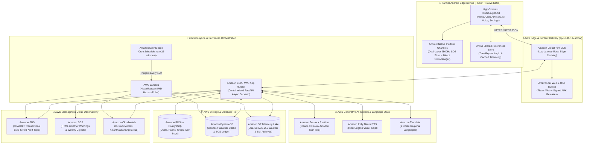

<div align="center">

# 🌾 किसान मौसम (KisanMausam)
### **AWS Cloud-Native, Hindi-First Hyper-Local Weather, Multi-Horizon IMD Hazard Early Warning & AI Crop Advisory Platform for Indian Farmers**

[-2E7D32?style=for-the-badge&logo=android&logoColor=white)](https://github.com/kumarnikki/Kisan-Mausam/releases/download/v1.0.0/kisan-mausam-release.apk)
[-FF9900?style=for-the-badge&logo=amazon-aws&logoColor=white)](./AWS_DEPLOYMENT_GUIDE.md)
[](./backend/app/services/aws_cloud_service.py)
[](./deploy/aws_lambda_weather_poller.py)
[-02569B?style=for-the-badge&logo=flutter&logoColor=white)](https://flutter.dev)
[](https://fastapi.tiangolo.com)
[](https://opensource.org/licenses/MIT)

<p align="center">
  <b>Built on Amazon Web Services (AWS) • Calibrated to IMD Hazard Standards & ICAR Package of Practices • TRAI DLT & DPDP Act 2023 Compliant</b>
</p>

[📲 **Download Android APK**](https://github.com/kumarnikki/Kisan-Mausam/releases/download/v1.0.0/kisan-mausam-release.apk) •
[☁️ **AWS Architecture & Deployment Guide**](./AWS_DEPLOYMENT_GUIDE.md) •
[📘 **Full System & API Documentation**](./PROJECT_DOCUMENTATION.md) •
[🏗️ **AWS CloudFormation IaC**](./deploy/aws-cloudformation.yaml)

</div>

---

## 🌟 Executive Overview

**KisanMausam (किसान मौसम)** is a production-grade, **AWS Cloud-Native agrometeorological intelligence and crop-protection platform** engineered for rural Indian farmers. It bridges the critical last-mile gap between complex meteorological telemetry and actionable, field-level agricultural decisions—delivered in plain, spoken **Hindi (`hi-IN`)** and regional Indian languages.

Designed for extreme resilience across rural 2G/3G/4G networks, KisanMausam combines a **high-contrast Material 3 Android application** (with native Kotlin hardware bridges) and an **asynchronous FastAPI cloud backend** powered by **14 Amazon Web Services (AWS)** in the **Asia Pacific (Mumbai — `ap-south-1`)** region.

---

## 📲 Direct Android APK Download (`v1.1.5+15`)

Install the latest signed release directly on any Android smartphone (Android 8.0 Oreo / API 26 and above):

> ### 📥 **[Click Here to Download `kisan-mausam-release.apk` (v1.1.5)](https://github.com/kumarnikki/Kisan-Mausam/releases/download/v1.0.0/kisan-mausam-release.apk)**

| Attribute | Specification |
| :--- | :--- |
| **Package ID** | `com.kisanmausam.app` |
| **Latest Release** | `v1.1.5+15` (Universal Multi-ABI Release Signed APK) |
| **Supported Languages** | Hindi (`hi-IN`) Primary • English (`en-IN`) Bilingual Toggle • 9 Indian Languages via **Amazon Translate** |
| **Key Capabilities** | Live GPS Weather & Soil Moisture • 3-Horizon IMD Hazard Engine • Emergency SOS 112 Dual-Layer Hardware Siren + Auto SMS • GPS-Calibrated ICAR Crop Recommender • Single-Utterance Hindi Voice Assistant |

---

## ☁️ Powered by Amazon Web Services (AWS) — Cloud-Native AgriTech Architecture

KisanMausam is architected from the ground up around **Amazon Web Services (`ap-south-1` Mumbai Region)** to guarantee low-latency delivery, serverless scalability during monsoon peak loads, carrier-grade SMS/voice alerting, and multi-model generative AI resilience.

### 🏛️ End-to-End AWS Cloud Architecture Diagram



### 🛠️ Complete Matrix of 14 AWS Services Implemented

| # | AWS Service | AWS SDK / IaC Integration | How KisanMausam Uses It in Production |
| :-: | :--- | :--- | :--- |
| **1** | **Amazon Bedrock** | `boto3.client('bedrock-runtime')`<br>[`aws_cloud_service.py`](./backend/app/services/aws_cloud_service.py) | Powers grounded Hindi agricultural advisories using **Claude 3 Haiku (`anthropic.claude-3-haiku-20240307-v1:0`)** and **Amazon Titan Text Express**, injected with live farm soil, crop-stage, and IMD hazard context. |
| **2** | **Amazon Polly (Neural)** | `boto3.client('polly')`<br>[`aws_cloud_service.py`](./backend/app/services/aws_cloud_service.py) | Synthesizes lifelike spoken Hindi (`hi-IN`) and Indian English (`en-IN`) audio weather bulletins using AWS Polly's **`Kajal` Neural Voice** (`POST /api/v1/aws/polly/synthesize`) for low-literacy accessibility. |
| **3** | **Amazon Translate** | `boto3.client('translate')`<br>[`aws_cloud_service.py`](./backend/app/services/aws_cloud_service.py) | Dynamically translates weather hazard alerts and ICAR crop practices across **9 Indian languages** (`hi`, `en`, `mr`, `pa`, `gu`, `ta`, `te`, `kn`, `bn`) via `POST /api/v1/aws/translate`. |
| **4** | **Amazon SNS** | `boto3.client('sns')`<br>[`sms_service.py`](./backend/app/services/sms_service.py) | Delivers high-priority **TRAI DLT Transactional SMS** (`AWS.SNS.SMS.SenderID=KSNMSM`, `SMSType=Transactional`) to farmers' registered phone numbers and fans out Red Alerts / SOS 112 events to `KisanMausamHazardTopic`. |
| **5** | **Amazon SES** | `boto3.client('ses')`<br>[`email_service.py`](./backend/app/services/email_service.py) | Sends rich bilingual HTML weather hazard warnings and weekly agro-meteorological digests to FPOs (Farmer Producer Organizations) and extension officers. |
| **6** | **AWS Lambda** | Python 3.11 Serverless Handler<br>[`aws_lambda_weather_poller.py`](./deploy/aws_lambda_weather_poller.py) | Serverless worker (`KisanMausam-IMD-Hazard-Poller`) that autonomously fetches Open-Meteo forecasts for active farm coordinates, evaluates IMD hazard rules, and triggers SNS alerts without human intervention. |
| **7** | **Amazon EventBridge** | `AWS::Events::Rule`<br>[`aws-cloudformation.yaml`](./deploy/aws-cloudformation.yaml) | Serverless cron scheduler (`rate(15 minutes)`) that invokes the AWS Lambda hazard poller every 15 minutes around the clock. |
| **8** | **Amazon DynamoDB** | `boto3.client('dynamodb')`<br>[`aws_cloud_service.py`](./backend/app/services/aws_cloud_service.py) | Provides single-digit millisecond NoSQL caching of hyper-local GPS geohash weather cells (`kisan_mausam_weather_cache`) with automatic 30-minute TTL expiration, plus an immutable SOS 112 audit ledger (`kisan_mausam_sos_events`). |
| **9** | **Amazon S3** | `boto3.client('s3')`<br>[`aws_cloud_service.py`](./backend/app/services/aws_cloud_service.py) | Stores **SSE-S3 (`AES-256`) encrypted** farm weather snapshots, root-zone soil moisture telemetry, and hazard audit logs (`s3://kisan-mausam-telemetry-ap-south-1/`) with 90-day **Amazon S3 Glacier** lifecycle rules. |
| **10** | **Amazon CloudFront** | `AWS::CloudFront::Distribution`<br>[`aws-cloudformation.yaml`](./deploy/aws-cloudformation.yaml) | Serves the Flutter web application and OTA Android APK updates from Indian Edge Locations (Mumbai, New Delhi, Chennai, Hyderabad, Kolkata) with TLS 1.3 and Brotli/Gzip compression. |
| **11** | **Amazon RDS (PostgreSQL)** | Async SQLAlchemy (`asyncpg`)<br>[`database.py`](./backend/app/database.py) | Primary ACID relational database storing farmer accounts (`Users`), multi-plot farm profiles (`Farms`), alert preferences (`AlertSubscriptions`), and delivery logs (`AlertDeliveryLogs`). |
| **12** | **Amazon EC2 & App Runner** | Docker Compose / Managed Container<br>[`aws-ec2-setup.sh`](./deploy/aws-ec2-setup.sh) | Runs the containerized FastAPI backend and Nginx reverse proxy on Ubuntu 24.04 LTS (`t3.small` in `ap-south-1`) or serverless **AWS App Runner**. |
| **13** | **Amazon CloudWatch** | `boto3.client('cloudwatch')`<br>[`aws_cloud_service.py`](./backend/app/services/aws_cloud_service.py) | Collects custom real-time AgriCloud metrics (`HazardsDispatched`, `FarmsEvaluated`, `PollySynthesisCount`, `SNSSMSDispatched`, `LambdaExecutionDurationMs`) under the `KisanMausam/AgriCloud` namespace. |
| **14** | **AWS CloudFormation & IAM** | Infrastructure-as-Code (`YAML`)<br>[`aws-cloudformation.yaml`](./deploy/aws-cloudformation.yaml) | Declarative IaC stack provisioning all S3 buckets, CloudFront CDN, DynamoDB tables, SNS topics, Lambda functions, EventBridge rules, and least-privilege **AWS IAM Execution Roles**. |

---

## 📱 Mobile UI Design System & Field-Tested Experience

KisanMausam features a custom **Deep Forest Green (`#071A12`) & Harvest Gold (`#FF8F00`) Material 3 UI** engineered for **direct midday sunlight readability** and one-handed operation in the field:

| Screen / Module | Primary UI Components & Field Ergonomics |
| :--- | :--- |
| **1. OTP Login & DPDP Consent** | Zero-repeat persistent login with `+91` mobile OTP verification, Google/Email options, and explicit DPDP Act 2023 privacy toggles. |
| **2. Farmer & Crop Profile Setup** | Captures **Farmer Name**, **Current Crop** (10 popular crops + custom entry), **Land Area (Acres)**, **Auto-GPS Village/District**, **Crop Stage**, **Soil Type**, **Terrain**, and **Irrigation**. |
| **3. Live Weather, IMD Risks & SOS 112** | Dynamic WMO sky gradients, top-level Crop Advisory quick button, IMD 3-Horizon hazard banner, root-zone soil moisture cards, and one-tap **SOS 112 Dual-Layer Hardware Siren + Auto SMS**. |
| **4. AI Krishi Sahayak & Editable Settings** | Floating bottom-right Hindi/English voice assistant (`speech_to_text` + **Amazon Polly** / `flutter_tts`), plus an editable Farmer & Crop Profile card at the top of Settings. |

---

## 🚀 Key Functionalities & Engineering Highlights

### 1. 🚨 Multi-Horizon IMD Weather Hazard Engine
Calibrated to official **India Meteorological Department (IMD)** thresholds and **ICAR crop-stage sensitivity multipliers** (`sowing`, `vegetative`, `flowering`, `grain_fill`, `harvest`):
- **Horizon 1 (0–72 Hours — High Confidence):** Detects immediate threats including **Heavy Rainfall (`>64.5 mm`)**, **Extreme Downpour (`>115.5 mm`)**, **Severe Heatwave (`≥40°C` / `≥45°C`)**, **Frost / Cold Wave (`≤4°C`)**, **High Winds (`≥40 km/h`)**, and **Hailstorm/Thunderstorm (`WMO 95–99`)**.
- **Horizon 2 (Days 4–14 — Medium Confidence):** Multi-day cumulative wet-spell (`>120 mm` waterlogging risk) and prolonged dry-spell detection.
- **Horizon 3 (Days 15–45 — Seasonal Outlook):** Evaluates ECMWF/SEAS5 seasonal rainfall and temperature anomalies to guide irrigation scheduling and sowing windows.

### 2. 🆘 Dual-Layer Emergency SOS 112 Siren & Auto-SMS System
- **Hardware-Level Audio Siren:** Tapping **SOS आपातकालीन (112)** on the Home screen invokes our native Android Kotlin bridge (`com.kisanmausam.app/siren`), forcing `STREAM_ALARM` to **100% hardware volume** and synthesizing a **2500Hz / 880Hz alternating emergency square-wave siren** layered with a continuous `RingtoneManager.TYPE_ALARM` fallback and spoken Hindi TTS emergency broadcast.
- **Zero-Friction Automatic SMS Dispatch:** Automatically retrieves the farmer's registered login mobile number (`StorageService.getUserPhone()`)—requiring zero manual typing during an emergency—and dispatches a bilingual GPS-stamped SOS SMS via **Amazon SNS / Native Android `SmsManager`** while launching the `tel:112` emergency dialer.

### 3. 🌱 GPS-Calibrated Deterministic Crop Recommender (30 Seed Crops)
- Evaluates 30 Indian crops across **Kharif, Rabi, and Zaid** seasons using live GPS coordinates, real-time ambient temperature (`°C`), 10-day forecast rainfall (`mm`), root-zone soil moisture (`0–1 cm`), soil type, terrain, and irrigation availability.
- Computes a transparent **$0\text{–}100\%$ Agronomic Suitability Score** and provides sowing windows, seed rates (`kg/acre`), water requirements, and local Mandi market potential.

### 4. 🎙️ Single-Utterance Hindi Voice Assistant (AI Krishi Sahayak)
- **Wait-for-Silence Speech Recognition:** Uses `speech_to_text` (`hi_IN` / `en_IN`) with a 2.5-second silence detector (`SpeechRecognitionResult.finalResult`) so the farmer's complete spoken question is captured and sent as a **single unified message** after they finish speaking.
- **Multi-Model Cloud AI Cascade:** Powered by **Google Gemini (`gemini-3.5-flash-lite`)** + **Amazon Bedrock (`Claude 3 Haiku`)** + **ICAR Deterministic Expert Fallback**, strictly constrained to **concise, actionable 2-sentence Hindi responses ($\le 35$ words)** with zero chemical dosage hallucinations and one-tap **KVK Helpline (`1800-180-1551`)** dialing.

### 5. 👤 Complete Farmer Onboarding & Editable Settings Profile
- **First-Time Account Setup:** Prompts new users signing in with their phone number for **Farmer Name**, **Current Crop** (10 popular crops + custom entry), **Land Area (Acres)**, **Village/District (Auto-GPS)**, **Crop Growth Stage**, **Terrain**, **Soil Type**, and **Irrigation Source**.
- **Instant Profile Editing:** Farmers can update their name, current crop, land size, and growth stage anytime from the **Settings (`सेटिंग्स`)** screen, immediately recalibrating all home-screen IMD risk warnings and AI advisories.

---

## 🔌 REST API Reference (`/api/v1`)

Interactive OpenAPI / Swagger documentation is available at `http://<HOST>:8000/docs`.

### ☁️ AWS Cloud Services Endpoints (`/api/v1/aws`)
| Method | Endpoint | AWS Service | Description |
| :---: | :--- | :--- | :--- |
| `GET` | `/api/v1/aws/status` | **AWS STS / All 14 Services** | Returns live AWS region (`ap-south-1`), SDK status, and configuration of all integrated AWS services. |
| `POST` | `/api/v1/aws/polly/synthesize` | **Amazon Polly (`Kajal`)** | Synthesizes natural Hindi (`hi-IN`) or Indian English (`en-IN`) neural speech audio from advisory text. |
| `POST` | `/api/v1/aws/translate` | **Amazon Translate** | Translates weather warnings & crop advisories across 9 Indian languages (`hi`, `en`, `mr`, `pa`, `gu`, `ta`, `te`, `kn`, `bn`). |
| `POST` | `/api/v1/aws/telemetry/archive` | **Amazon S3 + DynamoDB** | Archives encrypted (`AES-256`) farm weather/soil snapshots to S3 and caches geohash cells in DynamoDB. |
| `POST` | `/api/v1/aws/sns/broadcast` | **Amazon SNS** | Publishes emergency weather/SOS alerts to `KisanMausamHazardTopic` and dispatches Transactional DLT SMS. |

### 🌾 Core Application Endpoints
| Method | Endpoint | Category | Description |
| :---: | :--- | :--- | :--- |
| `POST` | `/api/v1/auth/otp/send` | Authentication | Dispatches 6-digit login OTP via MessageCentral VerifyNow v3 / Amazon SNS. |
| `POST` | `/api/v1/auth/otp/verify` | Authentication | Validates OTP, creates/updates `User` & DPDP consent flags, and issues a JWT Bearer token. |
| `POST` | `/api/v1/farms` | Farm Profile | Registers a farm plot with GPS coordinates, crop, stage, land area, soil, and irrigation. |
| `GET` | `/api/v1/weather/forecast` | Weather & Soil | Fetches hourly (48h) & daily (10d) weather, root-zone soil moisture, and UV index. |
| `GET` | `/api/v1/alerts/risk/{farm_id}` | IMD Risk Engine | Computes Horizon 1 (1–3d), Horizon 2 (4–14d), and Horizon 3 (15–45d) crop-specific risks. |
| `POST` | `/api/v1/alerts/trigger-Instant` | Alert Dispatcher | Triggers immediate SMS (Amazon SNS / Native), Email (Amazon SES), and Push alerts. |
| `POST` | `/api/v1/crops/recommend` | Crop Advisory | Ranks top 5 suitable crops ($0\text{–}100\%$) calibrated to live GPS weather & soil profile. |
| `POST` | `/api/v1/ai/chat` | AI Krishi Sahayak | Grounded Hindi farming advice via Gemini + **Amazon Bedrock** + ICAR rule engine. |

---

## ⚡ Quick Deployment on AWS & Local Development

### A. Deploy Full AWS Cloud Stack (`ap-south-1` Mumbai)

#### 1. Provision Serverless & Storage Infrastructure via AWS CloudFormation
```bash
aws cloudformation deploy \
  --template-file deploy/aws-cloudformation.yaml \
  --stack-name kisan-mausam-production \
  --region ap-south-1 \
  --capabilities CAPABILITY_NAMED_IAM
```

#### 2. Automated One-Command Deployment on Amazon EC2 (Ubuntu 24.04 LTS)
```bash
ssh -i "kisan-key.pem" ubuntu@<YOUR-EC2-PUBLIC-IP>
git clone https://github.com/kumarnikki/Kisan-Mausam.git
cd Kisan-Mausam
chmod +x deploy/aws-ec2-setup.sh
./deploy/aws-ec2-setup.sh
```
👉 See **[`AWS_DEPLOYMENT_GUIDE.md`](./AWS_DEPLOYMENT_GUIDE.md)** for full instructions covering **AWS App Runner**, **Amazon S3 + CloudFront**, **Amazon RDS**, **Amazon Bedrock**, and **Amazon Polly**.

---

### B. Local Development & Testing

#### 1. Backend (FastAPI + AWS Cloud SDK)
```bash
cd backend
python -m venv venv
# Windows: .\venv\Scripts\activate  |  Linux/macOS: source venv/bin/activate
pip install -r requirements.txt

# Run the complete automated test suite (including AWS Cloud Service tests)
python -m pytest tests -v

# Start the FastAPI server
python -m uvicorn app.main:app --host 0.0.0.0 --port 8000 --reload
```

#### 2. Mobile App (Flutter Android / Web)
```bash
cd app
flutter pub get

# Run Flutter widget & integration tests
flutter test

# Build release Android APK
flutter build apk --release
```

---

## 🔑 Environment Configuration (`backend/.env`)

| Variable | AWS / External Service | Default / Example |
| :--- | :--- | :--- |
| `AWS_REGION` | Primary AWS Region | `ap-south-1` (Asia Pacific — Mumbai) |
| `AWS_ACCESS_KEY_ID` | AWS IAM Access Key (Optional if using EC2/App Runner IAM Role) | `AKIA...` |
| `AWS_SECRET_ACCESS_KEY` | AWS IAM Secret Key (Optional if using EC2/App Runner IAM Role) | `...` |
| `AWS_BEDROCK_MODEL_ID` | Amazon Bedrock Foundation Model ID | `anthropic.claude-3-haiku-20240307-v1:0` |
| `AWS_POLLY_VOICE_ID` | Amazon Polly Neural Voice (`hi-IN` / `en-IN`) | `Kajal` |
| `AWS_S3_BUCKET` | Amazon S3 Encrypted Telemetry & Audit Bucket | `kisan-mausam-telemetry-ap-south-1` |
| `AWS_DYNAMODB_WEATHER_TABLE` | Amazon DynamoDB Geohash Weather Cache Table | `kisan_mausam_weather_cache` |
| `AWS_DYNAMODB_SOS_TABLE` | Amazon DynamoDB SOS 112 Emergency Event Table | `kisan_mausam_sos_events` |
| `AWS_SNS_TOPIC_ARN` | Amazon SNS Hazard Fanout Topic ARN | `arn:aws:sns:ap-south-1:...:KisanMausamHazardTopic` |
| `AWS_SNS_SENDER_ID` | TRAI DLT Registered 6-Char SMS Sender ID | `KSNMSM` |
| `AWS_SES_SENDER_EMAIL` | Verified Amazon SES Sender Identity | `alerts@kisanmausam.in` |
| `AWS_CLOUDWATCH_NAMESPACE` | Amazon CloudWatch Custom Metrics Namespace | `KisanMausam/AgriCloud` |
| `SMS_PROVIDER` | SMS Gateway Selector (`messagecentral`, `aws_sns`, `msg91`, `mock`) | `messagecentral` |
| `EMAIL_PROVIDER` | Email Gateway Selector (`aws_ses`, `resend`, `mock`) | `aws_ses` |
| `GEMINI_API_KEY` | Google Gemini API Key (Primary Edge/Cloud LLM) | Configured |
| `DATABASE_URL` | Amazon RDS PostgreSQL or Local SQLite URL | `sqlite+aiosqlite:///./kishan_mausam.db` |

---

## 🛡️ Regulatory, Privacy & Scientific Compliance

- **DPDP Act 2023 (India) Compliance:** Granular onboarding consent for GPS location, transactional SMS alerts, and AI advisory logs, paired with a one-tap **"डेटा हटाएं (Delete My Account)"** right-to-erasure control in Settings.
- **TRAI TCCCPR 2018 (DLT) Transactional SMS:** Pre-formatted Hindi and English templates (`KISAN_HAZARD_ALERT_HI`, `KISAN_HAZARD_ALERT_EN`, `KISAN_LOGIN_OTP`) designed for 6-character DLT Header (`KSNMSM`) delivery via **Amazon SNS** and **MessageCentral**.
- **Agronomic Safety Guardrails:** Strictly prohibits automated synthetic pesticide/chemical dosage generation; recommends biological/cultural controls first and provides one-touch dialing to the **Government of India Kisan Call Centre (`1800-180-1551`)** and **PMFBY Crop Insurance Helpline (`14447`)**.
- **Open-Meteo Attribution:** Weather forecast and soil telemetry powered by [Open-Meteo.com](https://open-meteo.com) under the Creative Commons Attribution 4.0 International (`CC BY 4.0`) license.
