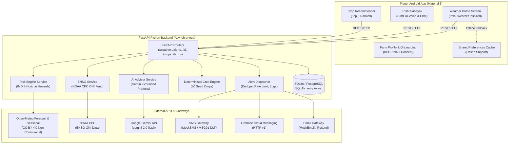

# 🌾 किसान मौसम (KisanMausam)

[](https://github.com/kumarnikki/Kisan-Mausam/releases/download/v1.0.0/kisan-mausam-release.apk)
[](https://flutter.dev)
[](https://fastapi.tiangolo.com)
[](./AWS_DEPLOYMENT_GUIDE.md)
[](https://opensource.org/licenses/MIT)

> **Hindi-First, Android-First Weather & Crop-Protection Platform for Rural Indian Farmers**  
> *Material 3 • Pixel-Weather Inspired • Low-Literacy Friendly • Multi-Horizon Risk Warnings • Offline Resilient • Auto GPS Geolocation*

---

## 📲 Direct APK Download (Android)

Anyone can download and install the complete, fully-functional Android APK directly for free:

📥 **[👉 Click Here to Download Kisan Mausam APK (v1.0.0)](https://github.com/kumarnikki/Kisan-Mausam/releases/download/v1.0.0/kisan-mausam-release.apk)**

- **File Name:** `kisan-mausam-release.apk`
- **Compatibility:** Android 8.0 (Oreo) and above
- **Permissions:** Internet, Location (GPS)
- **Features Included:** Live Open-Meteo Weather, 3-Horizon Hazards, Gemini AI Voice Assistant (TTS/STT), 30-Day Seasonal Outlook, Persistent Zero-Friction Login, Auto-GPS Geolocation.

---

## ☁️ AWS Deployment for Hackathon

Deploy backend & web frontend in under 3 minutes on **AWS Free Tier (EC2 t2.micro / t3.small)**:

```bash
# 1. Connect to your Ubuntu EC2 instance
ssh -i "your-key.pem" ubuntu@<YOUR-EC2-PUBLIC-IP>

# 2. Clone repo and run the automated one-click deployment script
git clone https://github.com/kumarnikki/Kisan-Mausam.git
cd Kisan-Mausam
chmod +x deploy/aws-ec2-setup.sh
./deploy/aws-ec2-setup.sh
```

👉 **[Read the Complete AWS Deployment Guide (AWS_DEPLOYMENT_GUIDE.md)](./AWS_DEPLOYMENT_GUIDE.md)** for detailed step-by-step instructions, AWS App Runner configuration, and SSL setup.

---

## 🌾 Overview

**KisanMausam** is a specialized agrometeorology and crop protection application designed specifically for rural farmers in India. It bridges the critical information gap between raw meteorological data and on-the-ground farming decisions by providing:

1. **Persistent Session & Zero-Repeat Setup:** Once an account is created or signed in for the first time, users are taken directly to the Home Screen every time the app opens. No repeated logins or forms are required unless the user manually clears app data or selects "Delete Account".
2. **Instant Auto-GPS Geolocation:** Upon launching the app, current GPS coordinates are automatically acquired to fetch real-time hyper-local weather and 30-day seasonal outlook for the farmer's immediate location.
3. **Hyper-Local Live Weather & Soil Health:** 48-hour hourly forecasts, 10-day forecasts, soil temperature, root-zone soil moisture (0-1cm), UV index, and day/night celestial visualizer powered by Open-Meteo.
4. **3-Horizon Hazard Risk Engine:** Calibrated with IMD (India Meteorological Department) warning criteria and crop-growth stage sensitivities (sowing, vegetative, flowering, grain-fill, harvest):
   - **Horizon 1 (Days 1–3, High Confidence):** Immediate hazards (heavy rain >64.5mm, heat wave, frost/cold wave <4°C, hail, strong winds >40 km/h).
   - **Horizon 2 (Days 4–10, Medium Confidence):** Extended hazard alerts with trend confidence.
   - **Horizon 3 (Days 10–46, Low-Medium Confidence):** Open-Meteo Seasonal Forecast API (ECMWF EC46 + SEAS5) anomaly probabilities for below-normal or above-normal rainfall and temperature over 2, 4, and 8 weeks.
5. **Monthly ENSO (El Niño / La Niña) Status Card:** Live NOAA CPC Oceanic Niño Index (ONI) and IRI probabilities with plain-Hindi explanations of Indian monsoon implications. Follows strict accuracy rules: **NEVER claims "El Niño is coming to your area"**, and always attributes official data sources.
6. **AI Krishi Sahayak (Hindi Voice & Chat):** Grounded farming assistant powered by Google Gemini (Gemini 2.0 Flash) with dynamic API Key configuration and local ICAR expert fallback. Spoken voice in/out with visible "बोलना रोकें (Stop)" button. Direct one-tap dialing to the **Kisan Call Centre (KVK Toll-Free: 1800-180-1551)**.
7. **Deterministic Crop Recommender & Knowledge Base:** 30 seed crops evaluated by agro-climatic season (Kharif, Rabi, Zaid), terrain, soil type, irrigation availability, and Horizon 3 seasonal rainfall outlook.
8. **Offline-First Resilience:** Client-side caching with "अंतिम अपडेट" timestamps, graceful degradation when offline, and low-bandwidth optimizations.

---

## 🏛️ System Architecture



---

## 🚀 Quick Start & Local Setup

### Prerequisites
- **Python 3.11+** installed
- **Flutter SDK 3.13+** installed
- **Android SDK & Android Emulator** (or physical Android device)
- **Git**

### 1. Backend Setup
```bash
# Navigate to backend directory
cd backend

# Create and activate virtual environment
python -m venv venv
# On Windows:
.\venv\Scripts\activate
# On Linux/macOS:
source venv/bin/activate

# Install dependencies
pip install -r requirements.txt

# Create .env configuration from example
copy .env.example .env

# Run unit and integration tests (15/15 tests)
pytest tests -v

# Start the FastAPI development server
python -m uvicorn app.main:app --host 0.0.0.0 --port 8000 --reload
```
The backend API documentation is available interactively at `http://127.0.0.1:8000/docs`.

### 2. Android App Setup
```bash
# In a new terminal, navigate to app directory
cd app

# Check Flutter environment
flutter doctor

# Run Flutter widget tests (7/7 tests)
flutter test

# Set up port forwarding from Android emulator to host FastAPI server
adb reverse tcp:8000 tcp:8000

# Run the app on connected Android emulator or device
flutter run
```

---

## 📜 Open-Meteo License Notice & CC BY 4.0 Attribution

- **Data Attribution:** Weather forecast data, historical observations, and seasonal anomalies are powered by [Open-Meteo.com](https://open-meteo.com).
- **License Terms:** Open-Meteo weather APIs are licensed under the **Creative Commons Attribution 4.0 International (CC BY 4.0)** license.
- **Commercial Usage:** The free tier of Open-Meteo is strictly available for **non-commercial use only** (< 10,000 daily API calls).
- **Production Commercial Deployment:** If KisanMausam is deployed for commercial operations or exceeds 10,000 calls/day, a commercial subscription with an API key must be acquired from Open-Meteo and configured via `OPEN_METEO_API_KEY` in `backend/.env`.
- **In-App Attribution:** Attribution to Open-Meteo is prominently surfaced on the Weather Home screen footer, the seasonal outlook cards, and within API responses.

---

## 📱 Indian Transactional SMS: TRAI DLT Registration Guide

In India, sending transactional or service-implicit SMS to mobile subscribers (such as weather warnings and disaster alerts) is strictly regulated by the Telecom Regulatory Authority of India (TRAI) under the **TCCCPR 2018 (Telecom Commercial Communications Customer Preference Regulations)** via **Distributed Ledger Technology (DLT)**.

Follow these 4 mandatory steps before going live with SMS alerts:

### Step 1: Principal Entity (PE) Registration
1. Register your organization/entity on any of the telecom operator DLT portals:
   - **Jio DLT:** `https://trueconnect.jio.com`
   - **Airtel DLT:** `https://www.airtel.in/business/commercial-communication`
   - **Vodafone Idea DLT (Vilpower):** `https://www.vilpower.in`
   - **BSNL DLT:** `https://www.ucc-bsnl.co.in`
2. Submit business documents (PAN, GSTIN, Letter of Authorization).
3. Obtain your unique **Principal Entity ID (PE ID)**.

### Step 2: Header (Sender ID) Registration
1. Under the DLT portal, navigate to **Headers > Add Header**.
2. Header Type: **Transactional / Service Implicit** (for agricultural and weather alerts).
3. Header Name: 6 alphabetical characters matching your entity name (e.g., `KSNMSM` or `MAUSAM`).
4. Justification: "Automated weather hazard warnings and crop protection alerts for registered farmers."

### Step 3: Consent Template Registration
1. Register the consent template describing user onboarding:  
   *"We collect explicit consent during mobile app onboarding to deliver critical weather alerts."*
2. Aligned with India's **Digital Personal Data Protection (DPDP) Act 2023**.

### Step 4: Content Template Registration
Content templates must be approved with strict variable syntax `{#var#}`. Register the exact bilingual templates configured in `backend/config/sms_templates.json`:

#### A. Hindi Weather Hazard Alert Template (Registered)
- **Template Name:** `KISAN_HAZARD_ALERT_HI`
- **Template Type:** Service Implicit
- **Header:** `KSNMSM`
- **DLT Template Text:**
  ```text
  किसान मौसम चेतावनी: {#var#} में अगले {#var#} में {#var#} की {#var#} संभावना। सलाह: {#var#}। विवरण: kisanmausam.in
  ```
- **Example Delivery:**
  ```text
  किसान मौसम चेतावनी: उमरेड में अगले 1-3 दिन में पाला/शीतलहर की 85% संभावना। सलाह: शाम को खेत में हल्की सिंचाई करें या मेड़ पर धुआं करें। विवरण: kisanmausam.in
  ```

#### B. English Weather Hazard Alert Template (Registered)
- **Template Name:** `KISAN_HAZARD_ALERT_EN`
- **DLT Template Text:**
  ```text
  KisanMausam Warning: {#var#} chance of {#var#} in {#var#} over next {#var#}. Action: {#var#}. Info: kisanmausam.in
  ```

#### C. OTP Login Template (Registered)
- **Template Name:** `KISAN_LOGIN_OTP`
- **DLT Template Text:**
  ```text
  किसान मौसम: आपका लॉगिन ओटीपी {#var#} है। यह 10 मिनट के लिए मान्य है। किसी के साथ साझा न करें।
  ```

---

## 🔑 Required API Keys & Environment Variables

Create your production `backend/.env` file with the following keys:

| `GOOGLE_WEATHER_API_KEY` | Google Maps Platform / Environment Weather API | [Google Cloud Console](https://console.cloud.google.com) | Open-Meteo CC BY 4.0 resilient fallback |
| `WEATHER_PROVIDER` | Weather API Provider Selector (`google` or `open_meteo`) | Configuration | `google` (falls back to Open-Meteo if key missing) |
| `GEMINI_API_KEY` | Google Gemini AI chat & crop advisory | [Google AI Studio](https://aistudio.google.com/) | Built-in offline fallback responses |
| `SMS_PROVIDER` | SMS Gateway Selector (`mock`, `msg91`, `twilio`) | Configuration | `mock` (logs to console & SQLite) |
| `MSG91_AUTH_KEY` | Transactional SMS provider in India | [MSG91 Dashboard](https://msg91.com) | Used when `SMS_PROVIDER=msg91` |
| `MSG91_SENDER_ID` | Approved 6-character TRAI DLT Sender ID | Telecom DLT Portal | e.g. `KSNMSM` |
| `FCM_CREDENTIALS_JSON` | Firebase Cloud Messaging HTTP v1 credentials | [Firebase Console](https://console.firebase.google.com) | Built-in Mock FCM logger |
| `EMAIL_PROVIDER` | Email Gateway Selector (`mock`, `resend`, `sendgrid`) | Configuration | `mock` (logs to delivery audit) |
| `RESEND_API_KEY` | Transactional email provider | [Resend Dashboard](https://resend.com) | Used when `EMAIL_PROVIDER=resend` |
| `OPEN_METEO_API_KEY` | Commercial Open-Meteo license (if >10k calls) | [Open-Meteo](https://open-meteo.com) | None needed for development |
| `DATABASE_URL` | PostgreSQL or SQLite connection string | Cloud DB / Local | `sqlite+aiosqlite:///./kisan_mausam.db` |

---

## 📋 List of Assumptions Made During Development

1. **Agro-Climatic Season Derivation:** Assumes standard Indian agricultural calendar: Kharif (June–Oct), Rabi (Oct–March), Zaid (March–June). October is treated as a sowing/harvesting transition window.
2. **Demo Farm Coordinates:** Default demo farm is set to Umred, Nagpur district, Maharashtra (`lat: 20.85, lon: 79.32`), a key pulse and soybean growing region on the Central Deccan plateau with black cotton soil.
3. **Connectivity Tolerant Design:** The app assumes rural 2G/3G connectivity is intermittent; all key weather, risk, and crop data are cached locally with fallback seeds to prevent app crashing when offline.
4. **DLT SMS Character Limits:** SMS messages are designed to fit within 160 GSM-7 characters or 70 Unicode Hindi characters to prevent excessive multi-part billing costs for farmers.
5. **No Direct Voice Hardware Requirement in Emulator:** The app provides both microphone-touch recognition and pre-grounded prompt chips with speech simulation so voice features can be verified on emulators without physical microphones.

---

## 🔬 Items Requiring Expert Agronomist Review

Before deploying KisanMausam for live commercial farm operations, the following items must be verified by certified agronomists from ICAR or State Agricultural Universities (SAUs):

1. **30 Seed Crop Profiles (`backend/app/services/crop_seed_data.py`):**
   - Minimum and maximum duration days per variety.
   - Exact water requirement figures (seasonal mm) across agro-climatic zones.
   - Temperature tolerance limits for germination and vegetative growth.
   - All 30 crops are currently tagged with `needs_expert_review: True` in the database.
2. **Hazard Severity Thresholds (`backend/config/risk_thresholds.json`):**
   - IMD criteria for heavy rain (>64.5mm), very heavy rain (>115.5mm), and extremely heavy rain (>204.4mm).
   - Ground frost threshold (soil temp <4°C vs air temp <2°C).
   - Plains vs. Hilly heatwave thresholds (40°C vs 30°C).
3. **Crop-Stage Sensitivity Weights:**
   - Sensitivity multipliers during the **flowering** and **grain-filling** stages (e.g. 1.4x - 1.5x vulnerability to heavy rain and frost).
4. **Preventive Agronomic Advice:**
   - Mulching straw thickness, light evening irrigation techniques during frost, and furrow drainage configurations.
   - **Chemical Guardrail Compliance:** Ensuring no automated chemical dosages (fertilizers, synthetic pesticides) are given without official KVK / package of practices validation.

---

## 🛡️ Privacy & DPDP Act 2023 Compliance

- **Granular Consent:** Explicit toggles during onboarding for GPS Location, SMS alerts, Email notifications, and AI conversation logging.
- **Data Minimization:** Only farm coordinates and crop parameters are collected; no personal tracking data is shared or sold.
- **Right to Erasure:** A prominent "डेटा हटाएं (Delete My Account)" button in the Settings screen permanently deletes all farm and personal records.
- **KVK Helpline:** Instant one-touch direct phone dialer to the Government of India Kisan Call Centre (`1800-180-1551`).
