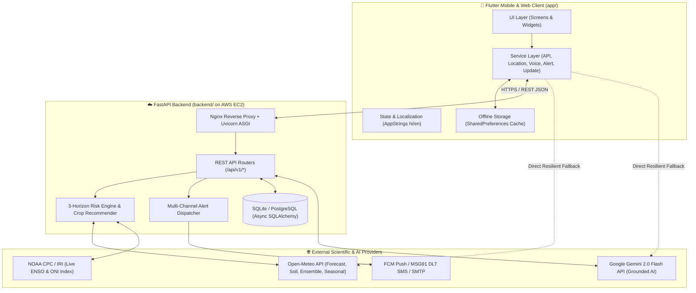
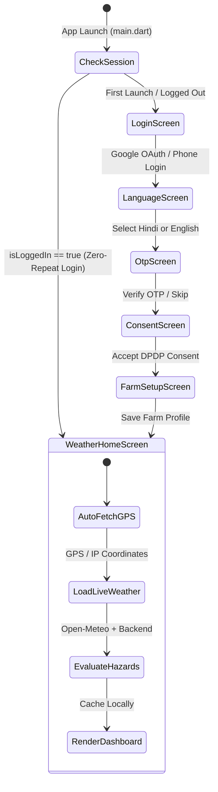
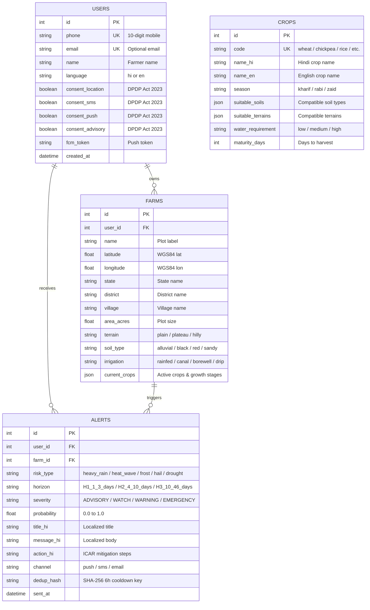
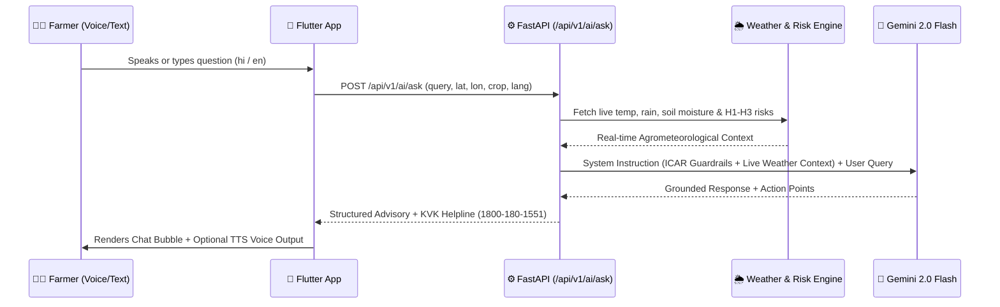

# 🌾 Kisan Mausam (किसान मौसम) — System Architecture, Frontend & Backend Walkthrough

**Kisan Mausam** is a Hindi-first, Android-first agrometeorology, multi-horizon hazard warning, and AI crop-advisory platform built for Indian farmers. It bridges meteorological science (Open-Meteo, ECMWF SEAS5/EC46, NOAA CPC ENSO, and IMD thresholds) with actionable, low-literacy-friendly field guidance grounded in ICAR standards.

- **GitHub Repository**: [`kumarnikki/Kisan-Mausam`](https://github.com/kumarnikki/Kisan-Mausam)
- **Direct Android APK**: [`kisan-mausam-release.apk`](https://github.com/kumarnikki/Kisan-Mausam/releases/download/v1.0.0/kisan-mausam-release.apk)

---

## 1. High-Level System Architecture

The platform follows a **resilient hybrid client-cloud architecture**. The Flutter mobile client can operate both connected to the FastAPI cloud backend (AWS EC2 / Docker) and autonomously via direct meteorological/AI fallbacks and local SQLite/SharedPreferences caching when rural connectivity is intermittent.

---

## 2. Frontend Architecture (`app/`)

The mobile application is built with **Flutter (Material 3)** and structured into modular layers under `app/lib/`:

### 2.1 Directory & Module Breakdown

| Layer | Key Files | Responsibility |
| :--- | :--- | :--- |
| **Entry & Navigation** | `app/lib/main.dart` | Initializes app theme, checks persistent login state (`isLoggedIn`), and manages the onboarding-to-home state machine. |
| **Localization (`l10n`)** | `app/lib/l10n/app_strings.dart` | Strict single-language dictionary (`hi` and `en`) ensuring zero dual-language clutter across all screens. |
| **Theme System** | `app/lib/theme/app_theme.dart` | Material 3 agricultural green palette (`#1B5E20`), high-contrast outdoor sunlight theme, and Noto Sans Devanagari typography. |
| **Data Models** | `weather_models.dart`, `risk_models.dart`, `farm_profile.dart` | Strongly-typed Dart models for hourly/daily forecasts, soil metrics, 3-horizon risks, ENSO data, and bilingual farm profiles. |
| **Home Screen** | `app/lib/screens/home/weather_home_screen.dart` | Primary dashboard featuring the decluttered location bar, 30°C hero card, one-time Voice Assistant banner, hazard warnings, ENSO status, 48-hour strip, soil health, and continuous 10-day forecast list. |
| **AI Voice & Chat** | `app/lib/screens/chat/krishi_sahayak_screen.dart` | Conversational interface with speech-to-text, text-to-speech playback (`Listen` / `Stop`), ICAR verification banner, KVK `1800-180-1551` dialer, and quick-reply chips. |
| **Crop Recommender** | `app/lib/screens/crops/crop_recommender_screen.dart` | Interactive filterable view ranking the top 5 crops by season, soil type, terrain, irrigation, and 30-day rainfall outlook. |
| **Onboarding Flow** | `login_screen.dart`, `language_screen.dart`, `otp_screen.dart`, `consent_screen.dart`, `farm_setup_screen.dart` | First-launch onboarding with Google Sign-In, OTP verification, DPDP Act 2023 granular consent, and farm plot registration. |
| **Settings & Hidden Dev Menu** | `app/lib/screens/settings/settings_screen.dart` | Farmer-facing settings (language toggle, high-contrast mode, DPDP account deletion, 1-tap app update) plus a 7-tap version number easter egg for Developer Server URL configuration. |
| **Custom Widgets** | `mic_button.dart`, `oni_gauge_meter.dart`, `temp_range_bar.dart`, `realistic_weather_visual.dart` | Compact 56px circular voice FAB, ENSO ONI index gauge, temperature gradient bars, and astronomical sun/moon/cloud visuals. |

### 2.2 Frontend State & Startup Flow

### 2.3 Frontend Core Services (`app/lib/services/`)

1. **`api_service.dart`**:
   - Manages HTTP communication with the FastAPI backend and Open-Meteo endpoints using `Dio`.
   - Implements automatic failover: if the backend server is unreachable, it seamlessly computes IMD risk warnings, fetches live Open-Meteo forecasts, and calls the Gemini REST API directly from the device with live GPS, weather, and crop context injected into the system prompt.
2. **`location_service.dart`**:
   - Acquires hardware GPS coordinates via `geolocator`, performs reverse geocoding (via Nominatim / BigDataCloud) to resolve village/district names in the active language, and provides forward geocoding for city/village search.
3. **`voice_service.dart`**:
   - Wraps `speech_to_text` (`hi-IN` and `en-IN` locales) and `flutter_tts` for hands-free voice queries and spoken advisory playback.
4. **`alert_service.dart`**:
   - Triggers local push notifications (`flutter_local_notifications`) and plays emergency audio alerts (`audioplayers`) for critical weather hazards.
5. **`update_service.dart`**:
   - Checks `version.json` on GitHub and the GitHub Releases API to notify users when a newer APK build is available for 1-tap download.
6. **`storage_service.dart`**:
   - Persists session tokens, language preferences, custom Gemini API keys, GPS coordinates, and offline weather/risk snapshots.

---

## 3. Backend Architecture (`backend/`)

The backend is an asynchronous **Python FastAPI** service using **SQLAlchemy 2.0 (AsyncIO)** and **Pydantic v2**.

### 3.1 Backend Directory & Service Breakdown

| Component | File Path | Description |
| :--- | :--- | :--- |
| **Application Entry** | `backend/app/main.py` | FastAPI app initialization, CORS middleware, lifespan auto-migration, health & version endpoints. |
| **Configuration** | `backend/app/config.py` | Environment settings (`DATABASE_URL`, `GEMINI_API_KEY`, `MSG91_AUTH_KEY`, `JWT_SECRET_KEY`, Open-Meteo endpoints). |
| **Database Layer** | `backend/app/database.py` | Async SQLAlchemy engine (`aiosqlite` for local/edge, `asyncpg` for PostgreSQL) and session dependency injection. |
| **Weather Service** | `backend/app/services/weather_service.py` | Queries Open-Meteo Forecast, Ensemble, and Seasonal APIs with an in-memory TTL cache to prevent rate limiting. |
| **3-Horizon Risk Engine** | `backend/app/services/risk_engine.py` | Evaluates Horizon 1 (Days 1–3), Horizon 2 (Days 4–10), and Horizon 3 (Days 10–46) anomalies against `backend/config/risk_thresholds.json`. |
| **ENSO Climate Service** | `backend/app/services/enso_service.py` | Parses live NOAA CPC Oceanic Niño Index (ONI) data and formats plain-Hindi/English monsoon impact summaries. |
| **AI Krishi Sahayak** | `backend/app/services/ai_advisor.py` | Grounds Google Gemini 2.0 Flash with live farm weather, soil moisture, active hazards, and ICAR safety guardrails. |
| **Crop Recommender** | `backend/app/services/crop_recommender.py`, `crop_seed_data.py` | Deterministic scoring algorithm across 30 Indian crops (Kharif, Rabi, Zaid) based on soil, irrigation, terrain, and seasonal outlook. |
| **Alert Dispatcher** | `alert_dispatcher.py`, `fcm_service.py`, `sms_service.py` | Dispatches hazard alerts via Firebase Cloud Messaging (FCM HTTP v1) and TRAI DLT-compliant MSG91 SMS with 6-hour deduplication. |

---

### 3.2 Database Entity-Relationship Schema

---

### 3.3 REST API Reference (`/api/v1`)

| Method | Endpoint | Router File | Purpose |
| :--- | :--- | :--- | :--- |
| `GET` | `/` | `backend/app/main.py` | Health check, DPDP compliance status, and Open-Meteo attribution. |
| `GET` | `/api/v1/app/version` | `backend/app/main.py` | Latest APK version metadata and GitHub release download URL. |
| `POST` | `/api/v1/auth/send-otp` | `backend/app/routers/auth.py` | Dispatches 6-digit OTP via SMS/Email. |
| `POST` | `/api/v1/auth/verify-otp` | `backend/app/routers/auth.py` | Verifies OTP, creates/loads user, and issues JWT access token. |
| `PUT` | `/api/v1/auth/consent/{user_id}` | `backend/app/routers/auth.py` | Updates granular DPDP Act 2023 consent flags. |
| `DELETE` | `/api/v1/auth/delete-account/{user_id}` | `backend/app/routers/auth.py` | Permanently erases user, farms, and alert history (Right to Erasure). |
| `POST` | `/api/v1/farms/` | `backend/app/routers/farms.py` | Registers a new farm plot with soil, irrigation, and crop stage data. |
| `GET` | `/api/v1/farms/user/{user_id}` | `backend/app/routers/farms.py` | Lists all registered farm plots for a farmer. |
| `GET` | `/api/v1/weather/forecast` | `backend/app/routers/weather.py` | Fetches 48-hour hourly, 10-day daily, UV, and root-zone soil forecast. |
| `GET` | `/api/v1/weather/risks` | `backend/app/routers/weather.py` | Computes 3-Horizon hazard warnings, seasonal outlook, and live ENSO status. |
| `POST` | `/api/v1/alerts/evaluate/{farm_id}` | `backend/app/routers/alerts.py` | Evaluates farm hazards and dispatches deduplicated Push/SMS alerts. |
| `POST` | `/api/v1/ai/ask` | `backend/app/routers/ai.py` | Conversational AI endpoint grounded in live farm weather & ICAR standards. |
| `POST` | `/api/v1/crops/recommend` | `backend/app/routers/crops.py` | Ranks top 5 suitable crops + drought-tolerant alternatives. |

---

## 4. Deep-Dive: Core Scientific & AI Pipelines

### 4.1 Multi-Horizon Hazard Risk Engine (`backend/app/services/risk_engine.py`)

The Risk Engine evaluates meteorological data across three distinct temporal horizons calibrated to **IMD (India Meteorological Department)** warning thresholds and crop growth-stage sensitivities:

1. **Horizon 1 (Days 1–3, High Confidence)**:
   - **Heavy Rainfall**: Daily precipitation >= 64.5 mm (`WARNING`) or >= 115.5 mm (`EMERGENCY`).
   - **Heat Wave**: Max temperature >= 40°C (plains) or +4.5°C anomaly during flowering/grain-fill.
   - **Frost / Cold Wave**: Min temperature <= 4°C (or <= 10°C cold stress advisory).
   - **Hailstorm & Squall**: WMO weather codes `96`, `99` or wind gusts >= 50 km/h (`40 km/h` for tall/lodging-sensitive crops).
2. **Horizon 2 (Days 4–10, Medium Confidence)**:
   - Evaluates multi-day cumulative rainfall deficits/surpluses and ensemble spread probabilities.
3. **Horizon 3 (Days 10–46, Seasonal Outlook)**:
   - Computes 30-day rainfall and temperature anomaly probabilities using Open-Meteo Seasonal Forecast models (ECMWF SEAS5 / EC46) combined with live **NOAA CPC ENSO** phase (El Niño / La Niña / Neutral).

### 4.2 Grounded AI Krishi Sahayak Pipeline (`backend/app/services/ai_advisor.py`)

---

## 5. Deployment & DevOps Architecture

- **Cloud Infrastructure**: Automated provisioning via `deploy/aws-ec2-setup.sh` and `docker-compose.yml` (Nginx reverse proxy + FastAPI systemd service + Flutter Web static bundle).
- **In-App Over-The-Air (OTA) Updates**: Hosted via `version.json` and GitHub Releases so installed APKs detect new builds automatically and offer a 1-tap update prompt.
- **Automated Verification**:
  - **Frontend**: 11 widget & integration test suites in `app/test/widget_test.dart` (`flutter analyze` — 0 issues, `flutter test` — 11/11 passing).
  - **Backend**: 4 phase test suites in `backend/tests/` covering auth, DPDP compliance, 3-horizon risk engine, AI grounding, and crop recommendations.
